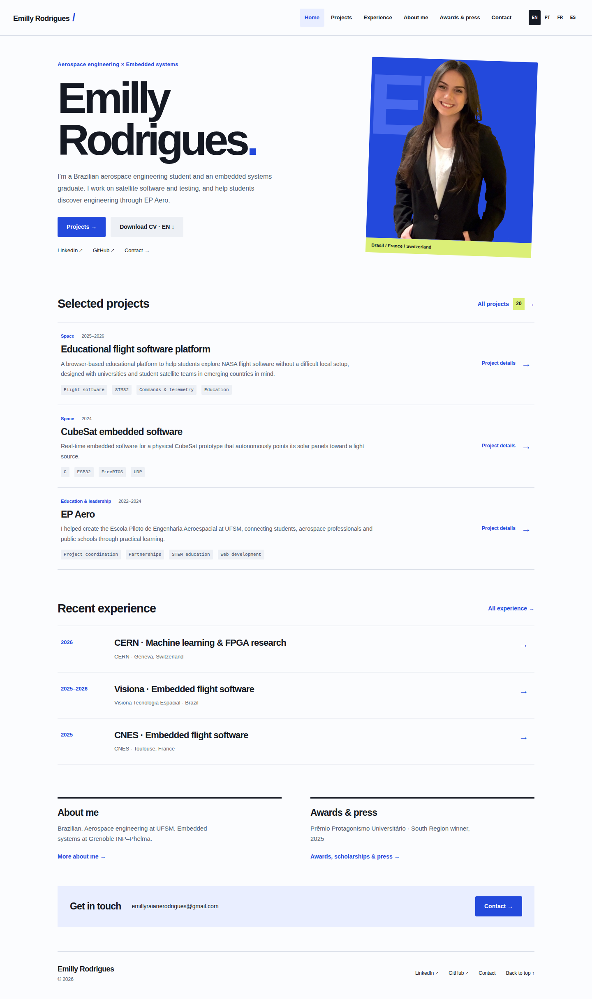

# Emilly Rodrigues · Portfolio

Portfólio de engenharia aeroespacial, sistemas embarcados e divulgação científica. Inglês por padrão, com versões completas em português, francês e espanhol.

20 projetos, 6 experiências profissionais, bolsas e premiações, páginas individuais, busca e filtros, links para demonstrações em vídeo e contato por e-mail. A identidade combina seu retrato, tipografia direta, branco, azul intenso e verde-lima, com botões sem bordas.

A navegação tem seis páginas: início, projetos, experiência, sobre mim, conquistas e contato. Todas ficam visíveis também no celular. O catálogo mostra os 20 projetos; busca e filtros são preservados ao abrir um trabalho, voltar aos resultados ou mudar o idioma.



[Prévia no celular](docs/preview-mobile.png) · [Catálogo no celular](docs/preview-projects.png) · [Resultado dos testes](docs/VALIDATION.md)

## Abrir localmente

As páginas HTML já estão geradas. Abra `index.html` ou execute:

```bash
python3 -m http.server 8000 --bind 127.0.0.1
```

Acesse **http://127.0.0.1:8000**. Não é necessário instalar bibliotecas para visualizar o site. Para encerrar o servidor, pressione `Ctrl+C`. Se a porta estiver ocupada, troque `8000` por `8137` no comando e no endereço.

## Publicar no GitHub Pages

O site está publicado em **https://raiagues.github.io/Emilly-s-Website/**, com GitHub Pages configurado para GitHub Actions. O repositório aponta para `git@github.com:Raiagues/Emilly-s-Website.git`. O fluxo `.github/workflows/pages.yml` está preparado para publicar a branch `main`.

1. Confira as alterações e envie os arquivos, incluindo os dois PDFs da raiz:

   ```bash
   git status
   git add .
   git commit -m "Redesign multilingual portfolio and configure GitHub Pages"
   git push origin main
   ```

2. No GitHub, abra **Settings → Pages → Build and deployment → Source → GitHub Actions**.
3. Abra **Actions → Publish portfolio to GitHub Pages**. Se o primeiro envio ocorreu antes da configuração de Pages e falhou, use **Run workflow** depois de ativar Pages.
4. Aguarde o job `deploy`. O endereço esperado é **https://raiagues.github.io/Emilly-s-Website/**. Esse endereço só representa a nova versão após o deploy concluir.

O fluxo gera e verifica as páginas antes da publicação. Apenas o conteúdo de `dist/` é enviado ao Pages; ferramentas, arquivos de trabalho, histórico Git e dependências ficam fora do site publicado. A URL canônica e o sitemap usam o endereço retornado pelo GitHub Pages, incluindo o nome do repositório.

Referência: [GitHub Pages com workflows](https://docs.github.com/en/pages/getting-started-with-github-pages/using-custom-workflows-with-github-pages).

## Ativar o formulário de e-mail

Destino confirmado: **emillyraianerodrigues@gmail.com**.

O formulário envia por POST ao [FormSubmit](https://formsubmit.co/), com verificação do provedor habilitada, campo antispam e link alternativo para e-mail direto.

1. Depois de publicar, preencha e envie uma mensagem de teste pelo site.
2. Abra o e-mail de ativação enviado pelo FormSubmit ao endereço acima; confira também o spam.
3. Confirme o endereço e envie uma nova mensagem de teste para verificar a entrega.

A ativação e a entrega real ainda precisam ser feitas pela proprietária. Os testes automatizados interceptam o POST e **não enviam e-mail real**. O site não afirma sucesso antes de uma resposta do provedor: a submissão segue para a página de verificação/confirmação do FormSubmit. Se o serviço estiver indisponível, o endereço direto continua visível.

Os visitantes são informados de que nome, e-mail e mensagem passam pelo FormSubmit. Nenhuma senha ou chave de e-mail deve ser colocada no código.

## Atualizar conteúdo

Requer **Python 3.12 ou mais recente** para gerar as páginas. O site publicado não depende de Python ou Node.

| Arquivo | O que editar |
| --- | --- |
| `content/data.py` | Textos nos quatro idiomas, projetos, experiências, conquistas, e-mail e links |
| `scripts/build.py` | Estrutura das páginas e configuração de publicação |
| `style/style.css` | Cores, tipografia, botões e layout responsivo |
| `scripts/artwork.py` | Gerador de ilustrações da versão anterior, preservado para consulta |
| `src/projects.js` | Busca, categorias e preservação dos filtros na URL e no retorno |
| `src/script.js` | Altura do menu, links antigos, retorno aos resultados e copiar e-mail |
| `CV_Emilly.pdf` | Currículo detalhado usado no botão de download |
| `content/SOURCES.md` | Origem das informações e divergências entre os currículos |

Os textos usam a ordem **inglês, português, francês e espanhol**, separados por ` | ` na função `L(...)`. Cada projeto usa a função `P(...)`. Mantenha identificadores existentes para preservar seus links.

Depois de editar:

```bash
python3 scripts/build.py
python3 scripts/check.py
```

Envie também os HTMLs gerados ao GitHub para manter a visualização local sincronizada. As páginas inglesas ficam na raiz; os outros idiomas usam `pt/`, `fr/` e `es/`. Os endereços antigos `pages/projects/project_*.html` e `pages/experience/experience_*.html` continuam funcionando. Os antigos exemplos incompletos redirecionam para o portfólio.

Para gerar com outro domínio fora do workflow:

```bash
SITE_URL=https://seu-dominio.example python3 scripts/build.py
```

O PDF mais novo por data de geração é `CV_Emilly.pdf` (17/10/2026). Seus arquivos originais não foram alterados. **Atenção editorial:** esse PDF ainda contém um e-mail diferente do confirmado para o site. Atualize o PDF na origem antes de divulgar o currículo, se esse endereço antigo não for mais seu.

## Verificar navegação e acessibilidade

Node.js 20+ é necessário apenas para os testes de navegador:

```bash
npm ci
npx playwright install chromium
npm run build
npm run check
npm test
```

Em Linux sem as bibliotecas de sistema do Chromium, use `npx playwright install --with-deps chromium`. Para aproveitar um navegador já instalado:

```bash
BROWSER_EXECUTABLE=/caminho/para/chrome npm test
```

A suíte usa um servidor temporário sob `/Emilly-s-Website/` para reproduzir o caminho de GitHub Pages. Verifica filtros, busca, estados vazios, quatro idiomas, menus, dimensões de 320 a 1440 px, envio interceptado do formulário, clipboard, funcionamento sem JavaScript, todas as páginas de detalhes e acessibilidade automática com axe. Os testes encerram seu próprio servidor.

A auditoria automática não substitui avaliação manual por pessoas com deficiência. Links externos, disponibilidade dos vídeos e entrega de e-mails dependem dos serviços respectivos.

## Imagens e conteúdo

- `img/me.png`: retrato original fornecido no repositório.
- `img/illustrations/`: ilustrações conceituais da versão anterior, preservadas no repositório. A interface atual não as utiliza.
- As páginas técnicas dão prioridade ao conteúdo e aos links de demonstrações. Os vídeos externos não forneceram miniaturas públicas acessíveis; não foram substituídos por imagens que poderiam parecer fotografias dos projetos.
- Nenhuma imagem externa, biblioteca de ícones ou fonte remota é necessária em tempo de execução.
- Os 18 projetos antigos foram preservados e atualizados, com dois novos projetos e três novas experiências profissionais.
- Os textos originais foram preservados em `content/archive-en.json` para consulta editorial; o arquivo não vai para o pacote publicado.
- As quatro competências adicionais que exigiam exemplos (negociação, decisões sob pressão, coordenação internacional e interface com clientes) ficaram de fora conforme solicitado.
